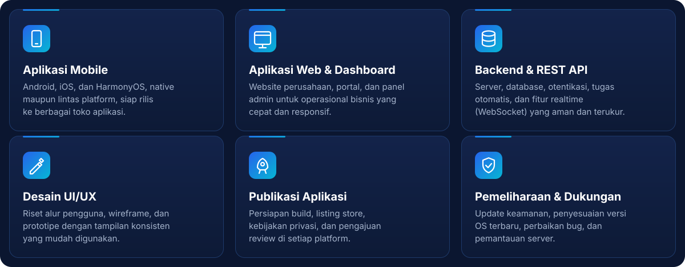
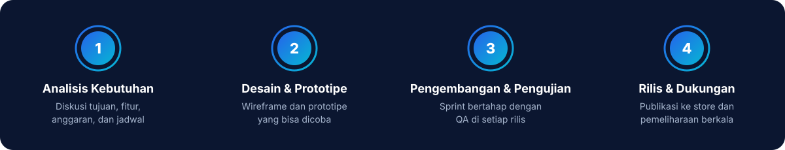
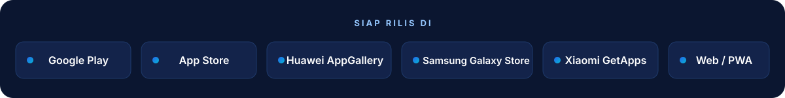
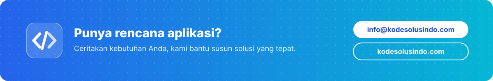

 

## 👋 Tentang Kami

**PT Kode Digital Solusindo** (Kode Solusindo) adalah *software house* Indonesia yang berkedudukan di Kota Medan, Sumatera Utara. Kami merancang, mengembangkan, dan memelihara **aplikasi mobile** (Android, iOS, HarmonyOS), **aplikasi web**, serta **sistem backend**, mulai dari ide awal hingga rilis di berbagai toko aplikasi, lengkap dengan dukungan setelahnya.

> Badan hukum resmi (Perseroan Perorangan, disahkan Kemenkumham 2026) · NIB 3110260029618

## 🧩 Layanan

## 🔄 Cara Kami Bekerja

## 🛠️ Teknologi

**Mobile**

**Web & Backend**

**Database & Infrastruktur**

## 🚀 Distribusi

## 📍 Kantor

| | |
|---|---|
| 🏢 **Lokasi** | Medan, Sumatera Utara - Indonesia |
| 🕘 **Jam kerja** | Senin–Jumat, 09.00–17.00 WIB |
| 🌏 **Area layanan** | Seluruh Indonesia (online) & klien internasional |

 

© 2026 PT Kode Digital Solusindo · Medan, Indonesia

